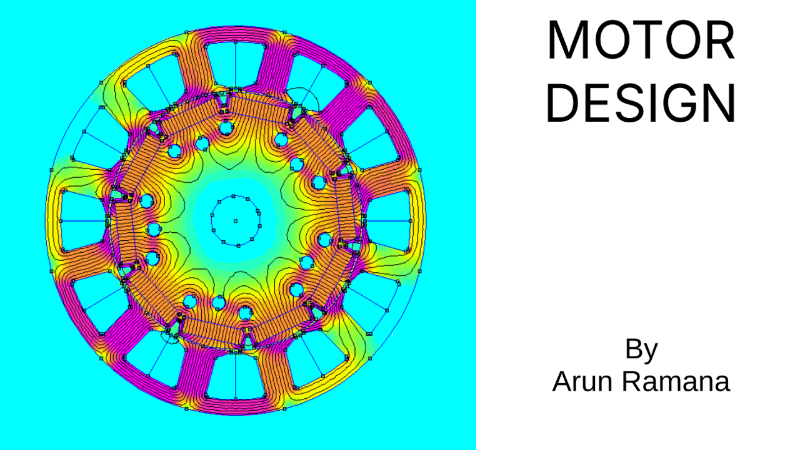
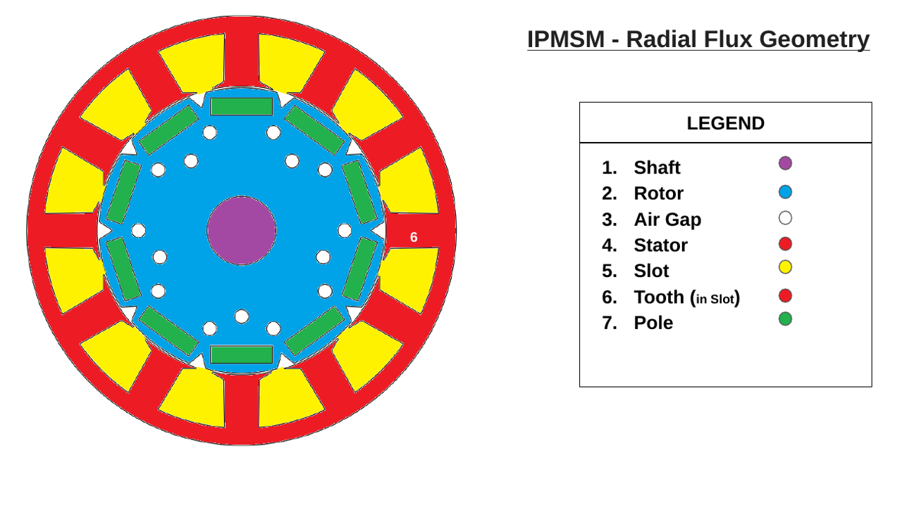
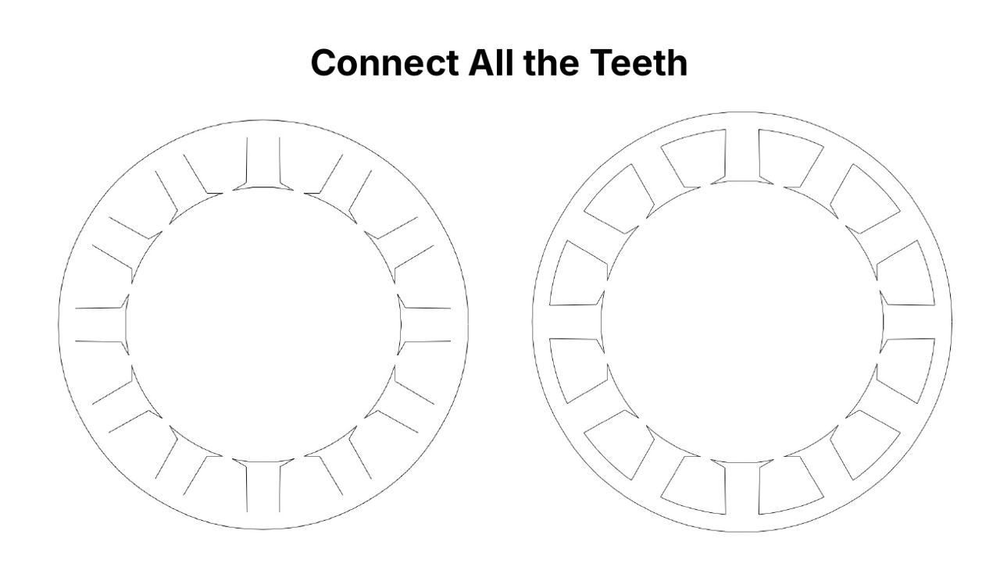
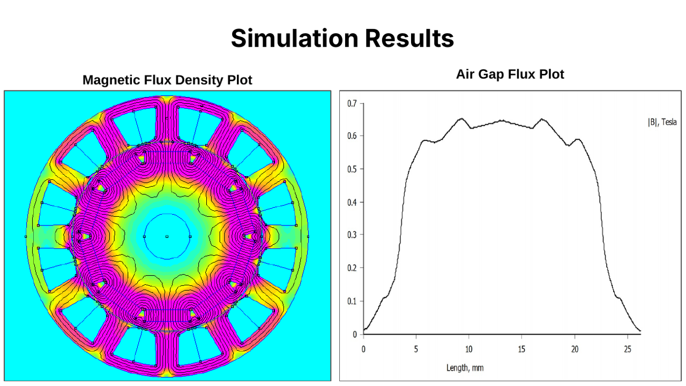

# PALS Motor Design Course

Course material for an online class that teaches engineering students from outside computer science how to design an electric motor by combining **electromagnetics**, **electrical engineering** and **software**, using the FEMM simulation tool.

I designed and taught this course to engineering students in India, Bangladesh and Nepal.



## The idea

A motor is designed by several disciplines at once. The physics is electromagnetic, the winding and drive side is electrical, and the geometry is a software problem: every dimension has to become coordinates that a CAD file and a simulator can read.

Most students arrive strong in one of these and unfamiliar with the others. The course gives them one concrete path through all three:

```
Specification  ->  Geometry math  ->  CAD drawing (DXF)  ->  FEMM simulation  ->  Results
(electrical)       (mathematics)      (software)              (electromagnetics)   (engineering judgement)
```

By the end, students have taken a motor specification, turned it into drawing coordinates with a small set of formulas, built the model in FEMM, and read the flux results.

## What the students design

A three-phase interior permanent magnet synchronous motor (IPMSM) with radial flux.

| Item | Value |
| --- | --- |
| Topology | IPMSM, radial flux |
| Slots and poles | 12 slots, 10 poles |
| Winding | Three-phase, double-layer, concentrated |
| Magnet | N42 rare earth |
| Steel | M250-35A |
| Wire | Copper, 20 SWG |
| Air gap | 0.5 mm |

Students receive the main dimensions from a design calculator (rotor and stator diameters, tooth thickness, slot depth, yoke thickness, stack length, pole length and width). The remaining values are stated as assumptions: 150 degree pole arc, 3 mm slot opening, 1 mm bridge thickness, 20 mm shaft and a 30 degree tooth tip angle.



## How the course is taught

The 30 slides follow one rule: never ask for a step before the vocabulary and the maths behind it have been introduced.

| Part | Slides | What it covers |
| --- | --- | --- |
| 1. Orientation | 2 to 5 | Learning goals, the tools (FEMM, CAD, DXF) and plain-language definitions of rotor, stator, air gap, slot, tooth, poles, pole arc, topology and magnetic flux |
| 2. The design problem | 6 to 10 | A colour-coded geometry legend, the winding diagram, the specification, the inputs and assumptions, and the expected output |
| 3. Geometry maths | 11 to 14 | DXF entities (points, lines, circles, arcs), Cartesian versus polar coordinates, why polar suits a circularly symmetric motor, and the conversion formulas |
| 4. Drawing the rotor | 15 to 19 | Work on one rotor segment, then repeat it. Shaft and rotor circles, then the magnet corner coordinates |
| 5. Drawing the stator | 20 to 25 | One stator segment, the tooth arc, the tooth tip and base, then connecting all the teeth |
| 6. Winding | 26 | Assigning U, V and W phases to the slots |
| 7. Simulation | 27 to 29 | Materials and windings in FEMM, boundary and mesh, then the flux density and air gap flux plots |

Teaching choices worth noting:

- **Define terms first.** Two slides of terminology, plus a numbered legend on the geometry, so nobody has to guess what "tooth" or "pole arc" means.
- **Work on one segment, then repeat.** The motor is symmetric, so students draw a single slot and pole and let the symmetry do the rest. This turns a daunting drawing into a repeatable step.
- **Pick the coordinate system that fits the problem.** The inputs are radii and angles, so the course uses polar coordinates and converts to Cartesian only at the end, when the CAD file needs it.
- **Show every formula next to its diagram.** Each drawing slide pairs a labelled figure with the exact expressions for the coordinates in it.

## Worked example: the deck's formulas as code

The slides give the formulas in plain maths. This is the same logic in Python, which shows how the geometry step becomes software. Angles are measured from the vertical axis, as in the deck.

```python
import math


def pole_inner_corners(pole_arc_deg, n_poles, pole_length, reference_deg=0.0):
    """Slide 18: the two inner corners (x1, y1) and (x2, y2) of one magnet."""
    pole_angle = pole_arc_deg * 2 / n_poles   # e.g. 150 * 2 / 10 = 30 degrees
    theta = math.radians(pole_angle / 2)
    theta1 = math.radians(reference_deg) + theta
    theta2 = math.radians(reference_deg) - theta
    radius = pole_length / (math.sin(theta) * 2)
    return ((radius * math.sin(theta1), radius * math.cos(theta1)),
            (radius * math.sin(theta2), radius * math.cos(theta2)))


def tooth_arc_half_angle_deg(stator_inner_radius, slot_opening, n_slots):
    """Slide 22: half the angle spanned by the arc on top of one tooth."""
    opening_total = 2 * math.pi * stator_inner_radius - slot_opening * n_slots
    tooth_arc_length = opening_total / n_slots
    tooth_arc_theta = tooth_arc_length * 2 / (2 * stator_inner_radius)  # stator_id = 2R
    return math.degrees(tooth_arc_theta) / 2
```

A quick check of the geometry: the two corners returned for a pole of length 20 are exactly 20 apart, and the other nine poles follow by adding 36 degrees (360 / 10) to `reference_deg`.



## Results

The model is built in FEMM with the materials and winding above. The magnetic flux density plot shows the field concentrating through the teeth and rotor iron between the magnets. The air gap flux plot gives the field around the gap, which peaks at roughly 0.65 T.



## What this repository shows about how I work

**Technical depth.**
Finite element electromagnetics, CAD and DXF geometry, coordinate geometry, Python, and reading simulation output.

**Working across disciplines.**
Motor design needs electromagnetics, electrical engineering and software at the same time. I learned each well enough to connect them, then packaged the connection as a course.

**Operating outside my home territory.**
Parts of this subject sat outside the field I started in. I treat that as normal work: learn the vocabulary, find the underlying maths, build a small working example, and only then explain it to others.

**Teaching and communication.**
The course takes learners from different engineering backgrounds to a working simulation without assuming shared knowledge. It uses plain-language definitions, one concept per slide, labelled diagrams and a clear order of steps.

**Turning teaching into tools.**
The same pipeline from specification to geometry to simulation is the basis of the [Electric Motor Design Tool](https://github.com/arunramana/motor_design_tool), which was transferred to ZOHO and runs there as [Pi-CADS Motor](https://www.pilabz.in/picads/).

## Repository contents

```
slides/
  PALS-Motor-Design-Course.pptx   Editable course deck (30 slides)
  PALS-Motor-Design-Course.pdf    Same deck as a PDF
images/                            Slide images used in this README
```

## Tools

[FEMM](https://www.femm.info/) (Finite Element Method Magnetics) for simulation, DXF for the geometry exchange format, and Python for the geometry calculations.

## Author

Arun Ramana Balasubramaniam. [Portfolio](https://arunramana.github.io/) | [GitHub](https://github.com/arunramana) | [LinkedIn](https://www.linkedin.com/in/arun-ramana-bba507148/) | arunr@bu.edu
